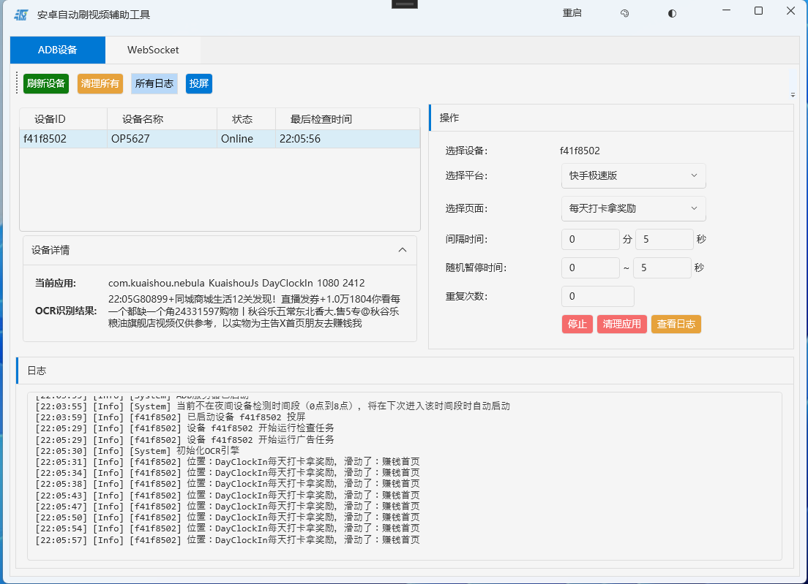
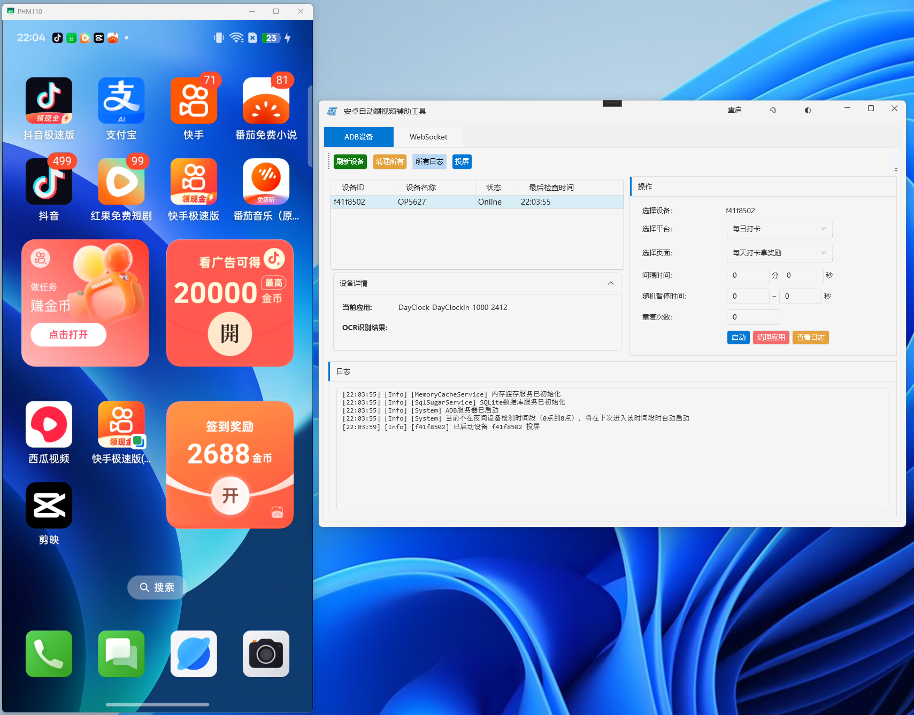

# Android Auto Video Assistant

A Windows desktop assistant for automating repetitive short-video tasks on Android devices. Built with **C# / WPF / ADB / OCR**, it connects to devices over USB debugging, recognizes on-screen text, and drives tap/swipe/back actions for multiple apps. It also supports real-time screen mirroring via scrcpy.

> For personal learning and automation research on devices you own only. Read the risk notice below and the full Chinese [README.md](README.md) before use.

## Preview





## ⚠️ Risk Notice

- **Mis-tap risk**: OCR and coordinate tapping are not reliable. Unexpected pop-ups may cause unintended taps (follow, share, purchase, payment). Disable one-click payment and never run on a phone you are actively using.
- **USB debugging risk**: enabling USB debugging grants the connected computer broad control over the device. Only use trusted computers and cables.
- **Privacy risk**: logs, screenshots and the local SQLite database may contain on-screen text and account information. Clean them before sharing.
- **Compliance**: follow local laws and platform rules. Do not use this project commercially or for mass account operation. You are responsible for any consequences.

A dedicated test device and test account are strongly recommended.

## Features

- Multi-device management over ADB: discover, start/stop per device, clear background apps.
- **Real-time screen mirroring**: select a device row and click **投屏** (Mirror) in the toolbar to open scrcpy for that device.
- Automation flows for Douyin, Douyin Lite, Kuaishou, Kuaishou Lite, Xigua, Fanqie FM / Novel, Hongguo, Hema and Alipay.
- Screen capture via ADB framebuffer + PaddleOCR text recognition + keyword-based page state machine.
- Task scheduling: interval, random pause range, repeat count, nightly device check, daily cleanup.
- Daily check-in flow for scheduled video/ad tasks.
- NLog file logging, TTS alerts, per-device logs.
- SQLite persistence (SqlSugar) and in-memory cache keyed by device.
- Optional local WebSocket bridge (`ws://127.0.0.1:33332`) for device info, screenshots and input commands.
- Fluent UI with light/dark theme.

## Requirements

- Windows 10/11 (x64)
- .NET 8 SDK
- Android device with USB debugging enabled
- `adb` available in `PATH` (or use the bundled `scrcpy/adb.exe`)
- Target apps installed on the device
- `scrcpy.exe` for screen mirroring: the repository ships a `scrcpy/` folder, or download [scrcpy](https://github.com/Genymobile/scrcpy/releases)

## Build & Run

```bash
git clone https://gitee.com/lixiaoliyubo/automatically-swipe-coins.git
cd automatically-swipe-coins
dotnet restore
dotnet build TimerCheckApp/TimerCheckApp.csproj -c Release
dotnet run --project TimerCheckApp/TimerCheckApp.csproj
```

Check the device connection first:

```bash
adb devices
```

Open `安卓自动刷视频辅助工具.sln` in Visual Studio 2022 if you prefer an IDE.

## Usage

1. Open the **ADB设备** tab and click **刷新设备**.
2. Configure interval, random pause and repeat count per device.
3. Choose a platform and click **启动**. Click **停止** to cancel.
4. To mirror a device: select its row, then click **投屏** in the toolbar. The app launches `scrcpy -s <deviceId>`. `scrcpy.exe` is searched in the app directory, up to five parent directories (including the repository `scrcpy/` folder) and `PATH`.
5. View global or per-device logs in the log panel.
6. The **WebSocket** tab connects to a local bridge service for remote device info and input commands.

## Documentation

The full documentation, supported package names, configuration details, FAQ and disclaimer are in the Chinese [README.md](README.md).

## License

[MIT License](LICENSE)