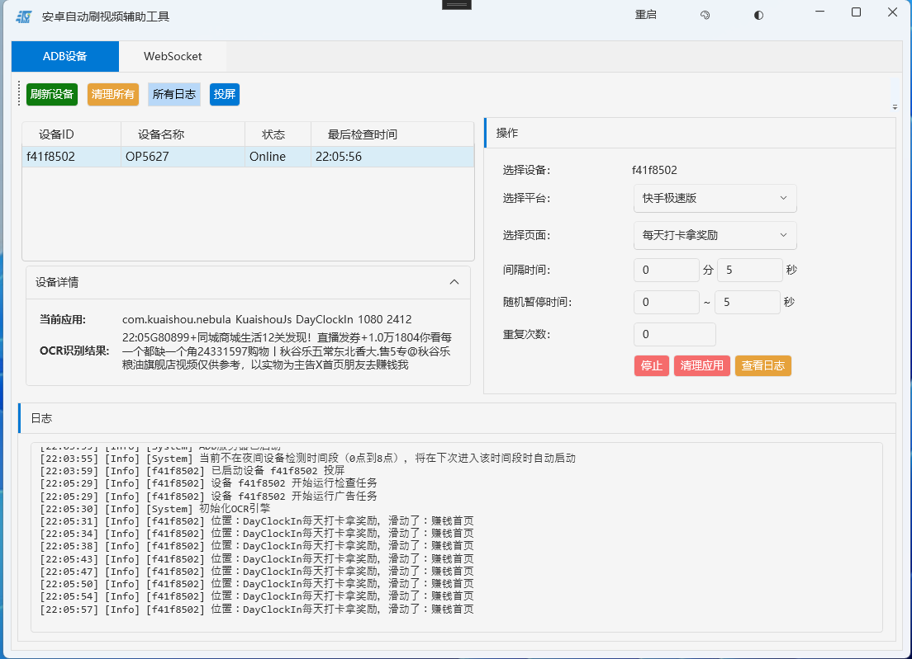
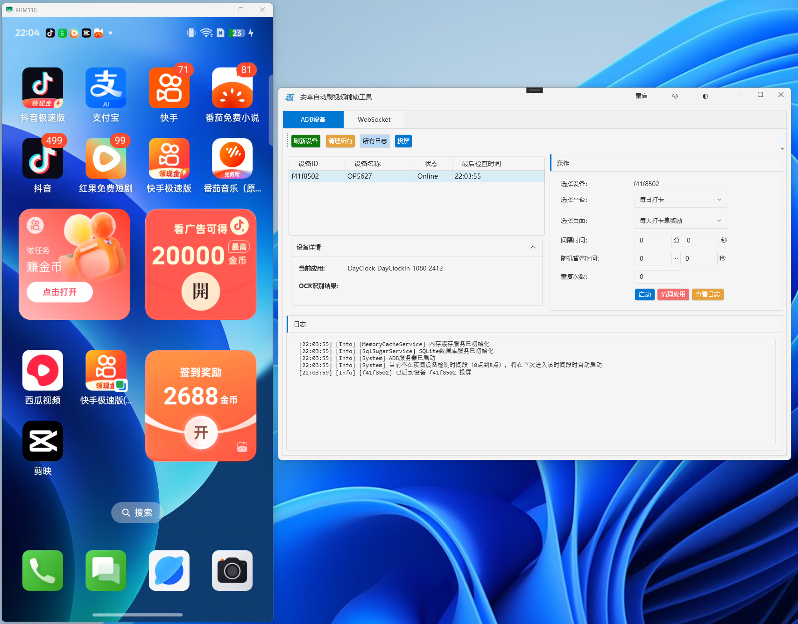

# 安卓自动刷视频辅助工具

基于 **C# + WPF + ADB + OCR** 的 Android 多设备自动化辅助工具。通过 USB 调试连接安卓设备，自动完成短视频平台的刷视频、看广告、签到打卡等重复任务，并提供设备管理、任务调度、实时投屏、日志查看与语音告警能力。

> 本项目仅用于个人自有设备的自动化学习与研究，请务必先阅读[风险提示](#风险提示)与[免责声明](#免责声明)。

## 界面预览





上图为程序主界面：设备列表、设备详情、任务参数与实时日志；下图为通过「投屏」按钮启动的 scrcpy 实时画面。

## 风险提示

> **使用前请认真阅读，继续使用即视为你已知悉并自行承担以下风险。**

- **误操作风险**：本工具依赖 OCR 文字识别与坐标点击，界面改版、弹窗广告、验证码等都可能导致识别失败或误点。误点可能触发关注、分享、下单、开通会员、免密支付等操作，请务必关闭免密支付、解绑大额支付方式，并避免在有人正常使用的设备上运行。
- **设备与调试风险**：开启 USB 调试后，电脑对设备拥有较高控制权限。请勿连接陌生电脑或使用来源不明的数据线；投屏会把手机画面实时显示在电脑上，注意周围环境与隐私。
- **数据风险**：日志、截图、SQLite 数据库均保存在程序运行目录，可能包含页面文字、账号昵称等信息，分享或提交问题前请先清理。
- **合规风险**：请遵守所在地法律法规及目标平台规则，不得将本工具用于商业牟利、批量养号、数据爬取等用途。因使用本工具产生的一切后果由使用者自行承担。
- 建议使用**专用测试设备与测试账号**，不要在主力机、主账号上直接运行。

## 功能特性

- **多设备管理**：自动发现已连接的 ADB 设备，支持按设备单独启动/停止任务、刷新设备列表、一键清理设备后台应用。
- **实时投屏**：在设备列表选中一行后点击工具栏「投屏」，即可通过 scrcpy 打开该设备的实时画面与键鼠控制（详见[投屏说明](#投屏说明)）。
- **多平台自动化**：内置抖音、抖音极速版、快手、快手极速版、西瓜视频、番茄畅听、番茄小说、红果短剧、河马剧场、支付宝等平台的页面识别与任务流程。
- **OCR 页面识别**：通过 ADB 抓取屏幕帧，使用 PaddleOCRSharp 识别界面文字，结合关键词与页面状态机完成点击、滑动、返回等操作。
- **任务调度**：支持检查间隔（分/秒）、随机暂停区间、重复次数、夜间设备检测与每日零点清理。
- **每日打卡**：独立的每日打卡流程，自动处理指定视频、广告、限时视频等打卡任务。
- **日志与告警**：NLog 按天写入日志文件；关键异常通过语音播报提醒；界面可查看全局日志或单设备日志。
- **数据持久化**：SQLite（SqlSugar）保存任务记录，内存缓存保存设备任务状态，所有状态按设备 ID 隔离。
- **WebSocket 扩展**：可连接本地 `ws://127.0.0.1:33332` 桥接服务，用于获取设备信息、截图以及转发点击/滑动指令。
- **界面主题**：基于 Yuandl.ThemeUI 的 Fluent 风格界面，支持明暗主题切换与应用重启。

## 已支持平台

平台与包名的对应关系定义在 [`TimerCheckApp/enums/PlatformType.cs`](TimerCheckApp/enums/PlatformType.cs)。

| 平台        | 包名                              | 说明                |
| --------- | ------------------------------- | ----------------- |
| 抖音        | `com.ss.android.ugc.aweme`      | 刷视频、看广告、任务中心      |
| 抖音极速版     | `com.ss.android.ugc.aweme.lite` | 刷视频、看广告、任务中心      |
| 快手        | `com.smile.gifmaker`            | 刷视频、直播间、金币购、逛街、打卡 |
| 快手极速版     | `com.kuaishou.nebula`           | 刷视频、任务中心          |
| 西瓜视频（极速版） | `com.ss.android.article.lite`   | 刷视频、金币任务          |
| 番茄畅听      | `com.xs.fm`                     | 听书、刷视频任务          |
| 番茄畅听音乐版   | `com.xs.fm.lite`                | 听书、刷视频任务          |
| 番茄小说      | `com.dragon.read`               | 看短剧、刷视频任务         |
| 红果短剧      | `com.phoenix.read`              | 看短剧任务             |
| 河马剧场      | `com.dz.hmjc`                   | 看短剧任务             |
| 支付宝       | `com.eg.android.AlipayGphone`   | 视频红包任务            |
| 每日打卡      | -                               | 独立打卡流程            |

> 应用版本更新后界面文案可能变化，识别规则需要同步调整，详见[常见问题](#常见问题)。

## 技术栈

| 类别      | 技术                                                      |
| ------- | ------------------------------------------------------- |
| 语言 / 框架 | C# 12、.NET 8（`net8.0-windows`）、WPF                      |
| 架构模式    | MVVM（CommunityToolkit.Mvvm）                             |
| 设备通信    | AdvancedSharpAdbClient、ADB                              |
| 屏幕识别    | PaddleOCRSharp、OpenCvSharp4                             |
| 投屏      | scrcpy（进程调用，按设备序列号启动）                                   |
| 日志      | NLog                                                    |
| 数据存储    | SqlSugar + SQLite、`Microsoft.Extensions.Caching.Memory` |
| 依赖注入    | Microsoft.Extensions.DependencyInjection                |
| 界面      | Yuandl.ThemeUI、Microsoft.Xaml.Behaviors.Wpf             |
| 音频      | System.Speech（TTS）                                      |

## 目录结构

```text
.
├── TimerCheckApp/                 # 主程序（WPF）
│   ├── AdWatching/                # 各平台自动化流程
│   │   ├── AdWatchingBase.cs      # 点击、滑动、OCR、任务状态等公共能力
│   │   ├── AdWatchingFactory.cs   # 平台实例工厂
│   │   ├── DouyinAdWatching.cs
│   │   ├── KuaishouAdWatching.cs
│   │   ├── DayClockAdWatching.cs
│   │   └── ...
│   ├── Models/                    # 设备、任务、日志、WebSocket 数据模型
│   ├── Services/                  # 设备、日志、缓存、数据库、音频、WebSocket 服务
│   ├── ViewModels/                # 主视图模型
│   ├── Views/                     # 主视图
│   ├── enums/                     # 平台、页面枚举
│   ├── Resources/                 # 样式与模板图片
│   └── NLog.config                # 日志配置
├── docs/images/                   # README 截图
├── scrcpy/                        # scrcpy 运行库（投屏功能使用）
├── Yuandl.Common.dll              # 主程序引用的本地组件
├── 安卓自动刷视频辅助工具.sln      # 解决方案
├── README.md
└── LICENSE
```

## 环境要求

- Windows 10 / 11（x64）
- [.NET 8 SDK](https://dotnet.microsoft.com/download/dotnet/8.0)
- Android 设备已开启「开发者选项 → USB 调试」，并通过 USB 连接电脑
- ADB 可用：将 `adb` 加入系统 `PATH`，或使用仓库中 `scrcpy/adb.exe` 所在目录
- 设备已安装需要自动化的目标应用
- 投屏功能需要 `scrcpy.exe`：仓库自带 `scrcpy/` 目录，也可自行下载 [scrcpy](https://github.com/Genymobile/scrcpy/releases)

> 首次连接设备时，请在手机端确认 USB 调试授权。

## 快速开始

1. 克隆仓库并进入项目目录：
   ```bash
   git clone https://gitee.com/lixiaoliyubo/automatically-swipe-coins.git
   cd automatically-swipe-coins
   ```
2. 使用 Visual Studio 2022 打开 `安卓自动刷视频辅助工具.sln`，或使用命令行构建：
   ```bash
   dotnet restore
   dotnet build TimerCheckApp/TimerCheckApp.csproj -c Release
   ```
3. 确认设备连接正常：
   ```bash
   adb devices
   ```
   设备状态应为 `device`，而不是 `unauthorized` 或 `offline`。
4. 运行程序：
   ```bash
   dotnet run --project TimerCheckApp/TimerCheckApp.csproj
   ```
   也可以在 `bin/Release/net8.0-windows/` 下直接运行 `TimerCheckApp.exe`。

## 使用说明

1. 启动程序后，在「ADB设备」页点击「刷新设备」，程序会自动读取设备列表与屏幕分辨率。
2. 在设备行中设置任务参数：
   - **间隔时间**：两次检查之间的间隔（分 + 秒）。
   - **随机暂停**：在固定间隔之外附加的随机等待区间（秒）。
   - **重复次数**：任务循环次数，`0` 表示不限制。
3. 选择平台后点击「启动」，程序会按平台流程执行自动化任务；点击「停止」结束该设备任务。
4. 「清理应用」可强制停止设备上的后台应用；「清理所有」会清理全部设备并清空日志。
5. 日志区域可切换「所有日志 / 单设备日志」，支持自动滚动到最新日志。
6. 程序每天 0 点自动清理任务与日志；夜间可开启设备在线检测，设备掉线时会记录并在界面提示。

### 投屏说明

1. 在设备列表（ADB设备页）中单击选中要投屏的设备行。
2. 点击工具栏中「所有日志」后面的「投屏」按钮。
3. 程序会以 `scrcpy -s <设备ID>` 启动投屏窗口，可实时查看画面并通过鼠标键盘控制设备。
4. 未选中设备时点击「投屏」，日志区会提示先选择设备。
5. `scrcpy.exe` 的查找顺序：程序目录下的 `scrcpy\`、程序目录、向上最多 5 级目录中的 `scrcpy\`、系统 `PATH`。找不到时会记录「未找到 scrcpy.exe」错误日志。

> 投屏窗口独立于主程序，关闭投屏窗口不会影响自动化任务；同一设备重复点击会启动多个投屏窗口。

### WebSocket 模式

「WebSocket」页用于连接本地桥接服务（默认 `ws://127.0.0.1:33332`）：

- 连接后可获取桥接服务上报的设备列表。
- 支持发起截图、点击、滑动等指令。
- 需要自行提供符合协议的服务端，协议模型见 [`TimerCheckApp/Models/WebSocketModels.cs`](TimerCheckApp/Models/WebSocketModels.cs)。

## 配置说明

| 配置项          | 位置                                                                          | 说明                        |
| ------------ | --------------------------------------------------------------------------- | ------------------------- |
| 日志级别与输出      | `TimerCheckApp/NLog.config`                                                 | 默认写入 `Logs/日期.log`        |
| SQLite 数据库   | `Database/AdAuto.db`                                                        | 首次运行自动创建                  |
| 截图目录         | `Screenshots/`                                                              | 程序启动时自动创建                 |
| 日志目录         | `Logs/`                                                                     | 程序启动时自动创建                 |
| WebSocket 地址 | `TimerCheckApp/Services/DependencyInjection/ServiceCollectionExtensions.cs` | 默认 `ws://127.0.0.1:33332` |
| scrcpy 路径    | 程序目录或仓库根目录的 `scrcpy/`                                                       | 投屏功能启动时自动查找               |

> `Logs/`、`Screenshots/`、`Database/` 均位于程序运行目录下，不纳入版本控制。

## 工作原理

```text
ADB 连接设备
   │
   ├─ 启动应用 / 读取当前包名
   │
   ├─ Framebuffer 截图 ──► PaddleOCR 文字识别
   │
   ├─ 关键词匹配 + 页面状态机（AppPageEnum）
   │
   ├─ 点击 / 滑动 / 返回键
   │
   ├─ 选中设备 ──► scrcpy -s <设备ID>（投屏）
   │
   └─ 记录任务时间、缓存状态、写入日志与数据库
```

各平台流程继承 `AdWatchingBase`，复用点击、滑动、OCR、返回、任务状态判断等公共方法，只实现自身的页面识别与任务分支。

## 常见问题

**Q：程序启动后找不到设备？**

检查 USB 调试是否开启、数据线是否支持传输、`adb devices` 是否能识别；若显示 `unauthorized`，请在手机上确认授权弹窗。

**Q：提示「启动 ADB 服务器失败」？**

确保 `adb` 已加入 `PATH`。也可以将 `scrcpy` 目录加入 `PATH`，或把 `adb.exe` 复制到系统目录。

**Q：点击「投屏」没有反应或提示未找到 scrcpy？**

确认已选中设备行，并检查程序目录、仓库根目录或 `PATH` 中是否存在 `scrcpy.exe`。也可解压 scrcpy 官方包到程序目录下的 `scrcpy` 文件夹后重试。

**Q：投屏窗口提示 adb 版本不匹配？**

程序与 scrcpy 可能使用不同版本的 adb。通常 scrcpy 会自动重启 adb 服务，稍等重试即可；若反复失败，请统一使用同一份 `adb.exe`。

**Q：OCR 识别不到界面文字？**

确认设备已解锁且屏幕常亮；部分系统需要关闭「隐私屏/安全屏」；分辨率过低时识别率会下降。

**Q：任务在某个页面反复点击或卡住？**

目标应用更新后文案或布局可能变化，需要在对应 `AdWatching` 类中调整关键词与匹配规则。

**Q：界面提示语音但听不到声音？**

检查系统音量与默认语音引擎；TTS 使用 Windows 系统语音，需在「设置 → 时间和语言 → 语音」中安装中文语音包。

**Q：数据库或日志在哪里？**

在程序运行目录的 `Database/`、`Logs/`、`Screenshots/` 下；这些目录不会提交到仓库。

## 参与贡献

1. Fork 本仓库并新建分支：`git checkout -b feat/your-feature`
2. 提交改动：`git commit -m "feat: 描述你的改动"`
3. 推送分支并创建 Pull Request
4. 涉及新平台时，请同时补充 `PlatformType`、工厂映射与页面识别说明

## 免责声明

- 本项目仅供个人学习、自动化技术研究与自有设备测试使用，不得用于商业用途、批量养号、刷量牟利或任何违法用途。
- 使用本工具可能违反目标应用的《用户协议》或平台规则，可能导致账号被限流、扣减收益、限制提现或封禁；请自行评估并承担风险。
- 自动化过程依赖 OCR 与坐标点击，存在误识别、误点击的可能，可能产生非预期操作（如关注、分享、下单、支付等），请务必做好账号与支付安全隔离。
- 开启 USB 调试与投屏会让电脑获得对设备的较高控制权限，请仅在可信电脑与可信网络环境下使用，并注意屏幕内容隐私。
- 本项目不提供任何账号、设备、网络资源或收益承诺，不保证自动化流程的稳定性、准确性与持续可用性。
- 因直接或间接使用本项目造成的账号损失、财产损失、数据泄露、法律纠纷及其他后果，作者与贡献者不承担任何责任。

## 许可证

本项目基于 [MIT License](LICENSE) 开源。
